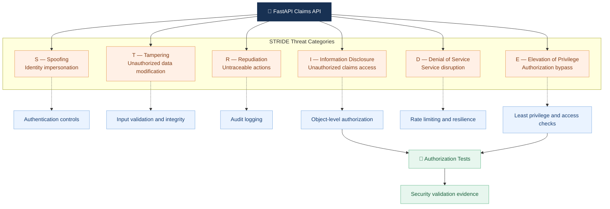

## STRIDE Threat Modeling & Security Validation

This project applies the **STRIDE threat modeling framework** to a FastAPI-based Claims API, identifying potential security threats, mapping them to defensive controls, and validating selected security behaviors through automated tests.

### Threat Model Overview

### Security Validation Focus

The lab demonstrates how threat modeling can inform practical security validation.

**Implemented validation focus:**
- Object-level authorization testing.
- Testing access to claims belonging to another user.
- Evaluating whether unauthorized requests are rejected.

**Additional STRIDE control areas:**
- Authentication and identity verification.
- Input validation and data integrity.
- Audit logging and accountability.
- Availability and resilience.
- Privilege enforcement.

These additional areas represent security considerations and potential extensions; their inclusion in the threat model does not imply that all controls have been implemented or tested.

### Supporting Documentation

- [Threat Model](docs/threat-model.md)
- [Security Findings](docs/security-findings.md)
- [Authorization Tests](tests/test_authorization.py)
