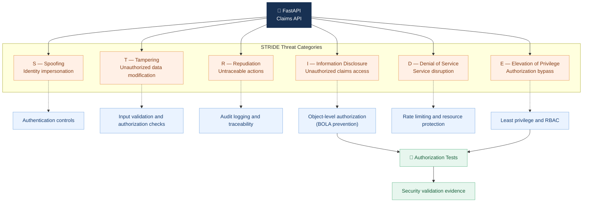

## STRIDE Threat Modeling & Security Validation

This project applies the **STRIDE threat modeling framework** to a FastAPI-based Claims API, identifying potential security threats, mapping them to defensive controls, and validating selected security behaviors through automated tests.

### Threat Model Overview



### Running the Application

### 1. Activate the Virtual Environment

```bash
source .venv/bin/activate
```

### 2. Start the Application

```bash
uvicorn app.main:app --reload
```

### 3. Verify the Application Is Running

```bash
curl http://127.0.0.1:8000/
```

The application should return a JSON response indicating that the Claims API is running.

### 4. Access Swagger UI

Open:

http://127.0.0.1:8000/docs

Swagger UI provides an interactive interface for executing and inspecting API requests.

### 5. Stop the Application

Press `Ctrl+C` in the terminal running Uvicorn.

---

## Security Validation Focus

This laboratory demonstrates how STRIDE threat modeling informs practical security testing using a FastAPI-based insurance Claims API.

### Current Implementation

- A fictional Claims API containing records belonging to different users.
- An API endpoint that retrieves claims using a claim identifier.
- A `user` query parameter that enables simulated cross-user access scenarios.
- Automated authorization tests using pytest.
- Screenshots documenting API requests and observed responses.

### Identified Security Risk

**BOLA — Broken Object Level Authorization**

The current API does not enforce ownership checks when retrieving claims.

Consequently, a requester can access another user's claim by providing its identifier.

Example:

```http
GET /claims/1002?user=Alice
```

Claim `1002` belongs to Bob, but the API returns the claim data when Alice is specified as the requester.

**STRIDE classification:**
- Information Disclosure — Unauthorized exposure of claim data.
- Elevation of Privilege — Access to objects beyond the requester's authorized scope.

### BOLA Authorization Test Results

The validation uses two fictional users and two insurance claims:

| Claim ID | Owner |
|---|---|
| 1001 | Alice |
| 1002 | Bob |

Four test scenarios demonstrate the expected and observed authorization behavior.

| Requester | Claim ID | Expected HTTP | Observed HTTP | Result |
|---|---|---|---|---|
| Alice | 1001 | 200 | 200 | PASS |
| Alice | 1002 | 403/404 | 200 | FAIL |
| Bob | 1002 | 200 | 200 | PASS |
| Bob | 1001 | 403/404 | 200 | FAIL |

**Finding:** The API returns HTTP 200 for cross-user requests, exposing claims without verifying ownership.

**Security conclusion:** Object-level authorization is missing from the tested implementation.

### Evidence

The following screenshots document the authorization tests:

- [Alice accesses her own claim](evidence/bola/01-alice-own-claim.jpg)
- [Alice accesses Bob's claim](evidence/bola/02-alice-requests-bobs-claim.jpg)
- [Bob accesses his own claim](evidence/bola/03-bob-own-claim.jpg)
- [Bob accesses Alice's claim](evidence/bola/02-bob-requests-alices-claim.jpg)
[View the architecture diagram](docs/images/Architecture-and-Flows.png)

### Recommended Security Controls

The identified vulnerability should be addressed through:

1. Authentication using a trusted identity provider.
2. Server-side object-level authorization.
3. Ownership verification before returning claim data.
4. HTTP 403 or 404 responses for unauthorized access.
5. Automated regression tests for both authorized and unauthorized requests.

### Validation Limitations

The current laboratory uses a user-controlled query parameter to simulate requester identity.

This is sufficient to demonstrate the missing ownership check but does not represent a secure authentication mechanism.

Future validation may incorporate JWT/OIDC authentication and authorization based on verified user identity.

### Validation Status

- [x] STRIDE threat identification
- [x] BOLA test scenarios defined
- [x] Unauthorized access reproduced
- [x] HTTP response evidence captured
- [ ] Object-level authorization implemented
- [ ] Remediation verified through regression testing

---

## Additional STRIDE Control Areas

The threat model also identifies the following security considerations:

- **Spoofing:** Authentication and identity verification.
- **Tampering:** Input validation and data integrity.
- **Repudiation:** Audit logging and accountability.
- **Denial of Service:** Rate limiting and resource protection.
- **Elevation of Privilege:** Least privilege and authorization enforcement.

These represent potential extensions of the laboratory. Their inclusion in the threat model does not imply that every security control has been implemented or validated.

---

## Supporting Documentation

- [Threat Model](docs/threat-model.md)
- [Security Findings](docs/security-findings.md)
- [BOLA Authorization Validation Report](reports/bola-authorization-test.md)
- [Automated Authorization Tests](tests/test_authorization.py)
- [BOLA Test Evidence](evidence/bola/)
