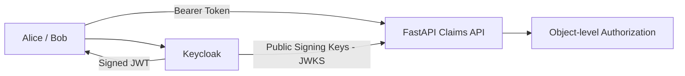

# 03 — Keycloak Integration

## Objective

Integrate Keycloak as the Identity Provider (IdP)
for the Novaris Insurance Claims API.

The objective is to replace user-supplied identities
with authenticated identities represented by
cryptographically signed JWT access tokens.

This provides the authentication foundation for
BOLA remediation.

## 1. Architecture



## 2. Keycloak Deployment

Keycloak runs as a Docker container in the Ubuntu
laboratory environment.

| Component | Configuration |
|---|---|
| Container | stride-keycloak |
| Identity Provider | Keycloak |
| Protocol | OpenID Connect |
| Host | 127.0.0.1 |
| Port | 8080 |
| Deployment mode | Development |

### Check container status

```bash
docker ps --filter name=stride-keycloak
```

### Start the existing container

```bash
docker start stride-keycloak
```

### Access the administration console

http://127.0.0.1:8080/admin/

## 3. Realm Configuration

A dedicated realm was created to isolate the
identity configuration for the STRIDE laboratory.

| Parameter | Value |
|---|---|
| Realm name | stride-lab |
| Issuer | http://127.0.0.1:8080/realms/stride-lab |

## 4. OIDC Client Configuration

An OpenID Connect client was configured for the
Claims API laboratory.

| Parameter | Value |
|---|---|
| Client ID | claims-api |
| Client type | OpenID Connect |
| Client authentication | OFF |
| Standard flow | Enabled |
| Direct access grants | Disabled |
| Implicit flow | Disabled |
| Authorization Code Flow | Enabled |
| PKCE | S256 |
| Valid redirect URI | http://127.0.0.1:8000/docs/oauth2-redirect |
| Web origin | http://127.0.0.1:8000 |

### Security rationale

The Authorization Code Flow with PKCE protects
against authorization code interception attacks.

The client is configured as a public client,
without a client secret.

## 5. Test Users

Two fictional identities are used to validate
authentication and object-level authorization.

| Username | Customer | Claim |
|---|---|---|
| alice | Alice | 1001 |
| bob | Bob | 1002 |

The expected authorization policy is that each
customer may access only their own insurance claims.

## 6. Audience Configuration

The access token audience must include `claims-api`
so that the resource server can verify that the
token is intended for this application.

The generated access token contained:

```json
"aud": [
    "claims-api",
    "account"
]
```

The Claims API will require `claims-api` as its
expected audience during JWT validation.

## 7. OpenID Connect Discovery

Keycloak publishes its OpenID Connect configuration
through the discovery endpoint.

```bash
curl -s \
  http://127.0.0.1:8080/realms/stride-lab/.well-known/openid-configuration \
  | python -m json.tool
```

The discovery document provides information about:

- Token issuer
- Authorization endpoint
- Token endpoint
- JWKS endpoint
- Supported signing algorithms
- Supported authentication flows

## 8. Access Token Generation

An access token for Alice was generated using
the Evaluate functionality in the Keycloak
administration console.

The decoded token contained the following
relevant claims:

```json
{
    "iss": "http://127.0.0.1:8080/realms/stride-lab",
    "aud": [
        "claims-api",
        "account"
    ],
    "azp": "claims-api",
    "preferred_username": "alice",
    "typ": "Bearer"
}
```

The token also contained the following claims:

- sub: Subject identifier
- exp: Expiration time
- iat: Issued-at time
- jti: JWT identifier

### JWT structure

A JWT consists of three components:

```text
HEADER.PAYLOAD.SIGNATURE
```

| Component | Purpose |
|---|---|
| Header | Algorithm and signing key identifier |
| Payload | Identity and token claims |
| Signature | Authenticity and integrity verification |

The signing algorithm used in this laboratory
is RS256.

Decoding a JWT does not establish its validity.
The resource server must verify its signature
and validate the relevant claims.

## 9. JWKS Endpoint

Keycloak publishes its public cryptographic keys
through the JSON Web Key Set endpoint.

```bash
curl -s \
  http://127.0.0.1:8080/realms/stride-lab/protocol/openid-connect/certs \
  | python -m json.tool
```

The endpoint successfully returned two RSA keys:

| Algorithm | Usage | Purpose |
|---|---|---|
| RSA-OAEP | enc | Encryption |
| RS256 | sig | Digital signature verification |

The Claims API uses the RS256 public signing key
to verify access tokens.

The corresponding private signing key remains
under the control of Keycloak.

## 10. Validation Results

| Validation | Result |
|---|---|
| Keycloak deployment | PASS |
| Realm configuration | PASS |
| OIDC client configuration | PASS |
| Alice access token generation | PASS |
| Token issuer inspection | PASS |
| Token audience inspection | PASS |
| JWKS endpoint availability | PASS |
| RSA signing key availability | PASS |
| Complete authorization code flow with PKCE | Pending |
| Bob access token validation | Pending |
| API-side JWT signature verification testing | Pending |

Validation date: 2026-11-24

## 11. STRIDE Security Mapping

| Threat | Security control |
|---|---|
| Spoofing | Federated authentication and signed JWTs |
| Tampering | JWT digital signature verification |
| Information Disclosure | Foundation for authenticated access |
| Elevation of Privilege | Foundation for authorization enforcement |

Authentication alone does not prevent BOLA.

Object-level authorization must be implemented
separately in the Claims API.

## 12. Current Limitations

- Keycloak runs in development mode.
- HTTP is used for local laboratory communication.
- Production-grade TLS is not configured.
- Token generation through the Evaluate interface
  does not validate the complete OIDC login flow.
- Object-level authorization remains pending.
- Access tokens and passwords must not be committed
  to the GitHub repository.

## 13. Next Steps

- [x] Deploy Keycloak
- [x] Configure the stride-lab realm
- [x] Configure the claims-api OIDC client
- [x] Generate an access token
- [x] Inspect JWT claims
- [x] Validate JWKS availability
- [x] Implement JWT authentication module
- [ ] Complete authentication security tests
- [ ] Implement object-level authorization
- [ ] Validate BOLA remediation

## Related Documentation

- [JWT Authentication](04-jwt-authentication.md)
- [Architecture](architecture.md)
- [Security Findings](security-findings.md)