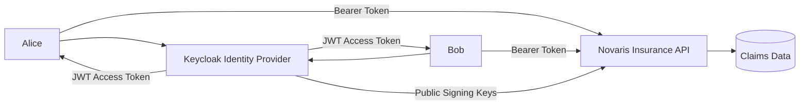
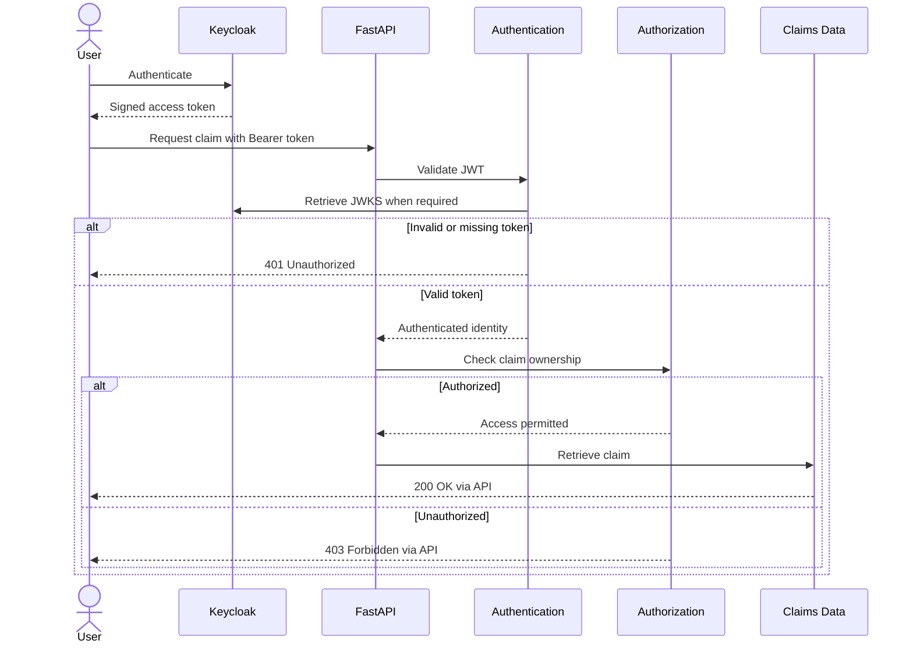

# Security Architecture

## 1. Executive Summary

The Novaris Insurance Claims API is a fictional
insurance application designed to demonstrate
threat modeling, security architecture, vulnerability
identification, remediation and security validation.

The project applies the STRIDE threat modeling
framework and focuses initially on Broken Object
Level Authorization (BOLA).

The target architecture separates authentication,
authorization and application business logic.

## 2. Architecture Objectives

- Apply Security by Design principles.
- Establish trusted user identities.
- Prevent unauthorized access to insurance claims.
- Separate authentication from authorization.
- Identify system trust boundaries.
- Apply least privilege and default-deny principles.
- Validate security controls through repeatable tests.
- Maintain traceable security evidence.

## 3. Technology Stack

| Component | Technology | Responsibility |
|---|---|---|
| Resource Server | FastAPI | REST API |
| Application Runtime | Python / Uvicorn | Application execution |
| Identity Provider | Keycloak | Identity and token issuance |
| Identity Protocol | OpenID Connect | Federated authentication |
| Token Format | JWT | Identity and security claims |
| Signing Algorithm | RS256 | Digital signature |
| JWT Validation | PyJWT | Token verification |
| Cryptography | cryptography | Cryptographic operations |
| API Testing | Swagger UI / curl | Manual validation |
| Automated Testing | pytest | Security regression testing |
| Version Control | Git / GitHub | Change management |
| Identity Deployment | Docker | Keycloak containerization |

## 4. System Context

## 5. Logical Security Architecture

The target architecture consists of four
logical layers.

### Identity Layer

Keycloak is responsible for:

- User identity management.
- User authentication.
- JWT access token issuance.
- Digital signing of tokens.
- Public signing key distribution through JWKS.

### Authentication Layer

The authentication module is implemented in
`app/auth.py`.

Its responsibilities include:

- Extracting Bearer tokens.
- Retrieving trusted public signing keys.
- Verifying digital signatures.
- Validating token issuer.
- Validating intended audience.
- Validating token expiration.
- Establishing the authenticated identity.

### Authorization Layer

The authorization layer will determine whether
the authenticated identity is permitted to access
the requested insurance claim.

The target implementation will enforce
object-level authorization using a trusted
subject identifier.

This layer is currently pending implementation.

### Business Logic and Data Layer

The application business logic is implemented
in `app/main.py`.

Insurance claims are currently stored in an
in-memory Python dictionary.

No external database is currently implemented.

## 6. Authentication and Authorization Flow

The following sequence represents the target
security architecture.

## 7. Trust Boundaries

| ID | Trust Boundary | Security Control |
|---|---|---|
| TB-01 | User to Identity Provider | OIDC authentication |
| TB-02 | User to Claims API | Bearer token validation |
| TB-03 | Identity Provider to API | Trusted issuer and JWKS |
| TB-04 | API to Claims Data | Object-level authorization |

All user-controlled input must be treated
as untrusted.

The application must not accept a user-supplied
username as proof of identity.

## 8. Network Architecture

| Component | Address | Port |
|---|---|---|
| FastAPI | 127.0.0.1 | 8000 |
| Keycloak | 127.0.0.1 | 8080 |

Communication currently uses HTTP within the
local development environment.

Production deployment would require HTTPS
and appropriate network security controls.

## 9. STRIDE Threat Model

| Threat | Example | Security Control | Status |
|---|---|---|---|
| Spoofing | Identity impersonation | JWT authentication | Testing |
| Tampering | JWT modification | Digital signature verification | Testing |
| Repudiation | Untraceable actions | Audit logging | Planned |
| Information Disclosure | Unauthorized claim access | Object-level authorization | Planned |
| Denial of Service | Excessive API requests | Rate limiting | Planned |
| Elevation of Privilege | Authorization bypass | Least privilege and access control | Planned |

## 10. Security Architecture Principles

### Separation of Responsibilities

Authentication, authorization and business
logic are treated as separate responsibilities.

### Least Privilege

Users should only access resources required
for their legitimate activities.

### Default Deny

Access should be denied unless explicitly
authorized.

### Defense in Depth

Authentication alone must not be considered
sufficient to protect sensitive resources.

### Zero Trust Alignment

Identity and authorization must be validated
before granting access to protected resources.

### Security Validation

Security controls must be supported by
observable and repeatable test evidence.

## 11. Architectural Decisions

| ID | Decision | Rationale |
|---|---|---|
| ADR-001 | Use Keycloak as Identity Provider | Separate identity management from business logic |
| ADR-002 | Use signed JWT access tokens | Enable verifiable token-based authentication |
| ADR-003 | Use RS256 | Avoid distributing private signing keys to the API |
| ADR-004 | Retrieve keys through JWKS | Support signing key rotation |
| ADR-005 | Separate authentication from authorization | Prevent authenticated users from accessing unauthorized objects |
| ADR-006 | Use pytest for security testing | Enable repeatable regression validation |
| ADR-007 | Use a dedicated Git remediation branch | Preserve the vulnerable baseline during development |
| ADR-008 | Use stable subject identifiers for ownership | Avoid relying on mutable usernames |

ADR-005 and ADR-008 describe target
authorization design decisions that are
not yet fully implemented.

## 12. Security Control Traceability

| Threat | Control | Implementation | Evidence |
|---|---|---|---|
| Spoofing | JWT authentication | app/auth.py | TC-AUTH-001 |
| Tampering | JWT signature validation | app/auth.py | Pending security tests |
| Information Disclosure | Object ownership validation | Planned | TC-BOLA-001 baseline |
| Elevation of Privilege | Object-level access control | Planned | Pending remediation tests |
| Repudiation | Security audit logging | Planned | Pending |
| Denial of Service | Rate limiting | Planned | Pending |

## 13. Current Implementation Status

- [x] FastAPI Claims API
- [x] STRIDE threat identification
- [x] BOLA vulnerability reproduction
- [x] Keycloak integration
- [x] JWKS endpoint validation
- [x] JWT authentication module
- [x] Protected identity endpoint
- [x] Missing-token rejection test
- [ ] Complete JWT security validation
- [ ] Object-level authorization
- [ ] BOLA regression testing
- [ ] Security audit logging
- [ ] Rate limiting

## 14. Architecture Limitations

- Local development environment.
- HTTP rather than HTTPS.
- In-memory claims data.
- No persistent database.
- Incomplete authentication security testing.
- Object-level authorization not yet implemented.
- No production-grade audit logging.
- No high availability or disaster recovery.
- No production secrets management.

## 15. Related Documentation

- [Requirements](requirements.md)
- [Security Findings](security-findings.md)
- [Keycloak Integration](03-keycloak-integration.md)
- [JWT Authentication](04-jwt-authentication.md)