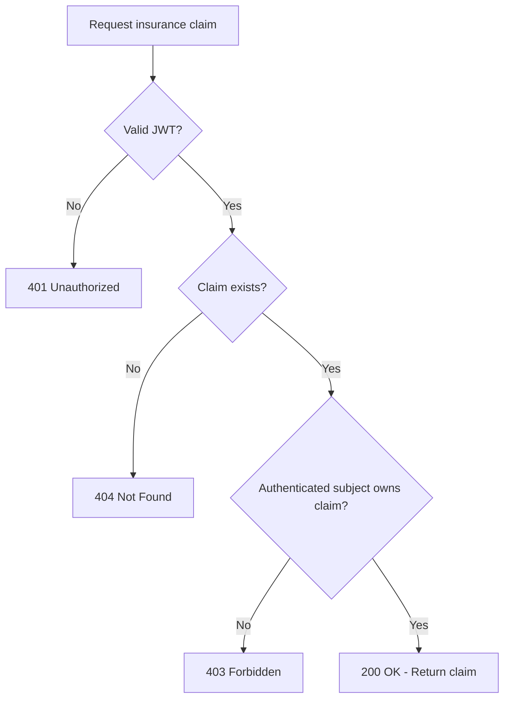

# 02 — BOLA Authorization Remediation

## 1. Objective

Remediate the Broken Object Level Authorization
(BOLA) vulnerability identified in the Novaris
Insurance Claims API.

Ensure that authenticated users can only access
insurance claims that they are authorized to view.

## 2. Vulnerability Reference

- OWASP API Security: API1:2023 — BOLA
- STRIDE: Information Disclosure
- STRIDE: Elevation of Privilege
- Baseline evidence: TC-BOLA-001

## 3. Root Cause Analysis

The original API implementation accepts a
user-supplied identity through a query parameter.

It does not verify whether the requesting user
owns the requested insurance claim.

Consequently, Alice can access Bob's claims,
and Bob can access Alice's claims.

## 4. Vulnerable Implementation

File: `app/main.py`

```python
@app.get("/claims/{claim_id}")
def get_claim(claim_id: int, user: str):
    if claim_id not in claims:
        raise HTTPException(
            status_code=404,
            detail="Claim not found"
        )

    return claims[claim_id]
```

### Security weaknesses

- Untrusted user-supplied identity.
- Missing authentication on the Claims endpoint.
- Missing object-level authorization.
- Unauthorized disclosure of insurance information.

## 5. Remediation Strategy

The proposed remediation consists of two
complementary security controls.

### Authentication

Replace the user-supplied identity with an
authenticated identity obtained from a validated
Keycloak JWT access token.

### Authorization

Verify that the authenticated subject owns the
requested insurance claim before returning its data.

Use the stable JWT subject identifier (`sub`)
rather than relying on a mutable username.

Authentication alone does not prevent BOLA.

## 6. Target Authorization Flow



## 7. Authorization Policy

| Requester | Resource | Decision |
|---|---|---|
| Alice | Alice's claim | Allow |
| Alice | Bob's claim | Deny |
| Bob | Bob's claim | Allow |
| Bob | Alice's claim | Deny |
| Unauthenticated user | Any claim | Deny |

Access is denied unless explicitly authorized.

## 8. Security Regression Test Plan

| Test ID | Scenario | Baseline | Expected after fix | Observed | Result |
|---|---|---|---|---|---|
| TC-BOLA-002 | Alice accesses claim 1001 | 200 | 200 | - | Pending |
| TC-BOLA-003 | Alice accesses claim 1002 | 200 | 403 | - | Pending |
| TC-BOLA-004 | Bob accesses claim 1002 | 200 | 200 | - | Pending |
| TC-BOLA-005 | Bob accesses claim 1001 | 200 | 403 | - | Pending |
| TC-BOLA-006 | Request without JWT | Not tested | 401 | - | Pending |
| TC-BOLA-007 | Request with invalid JWT | Not tested | 401 | - | Pending |
| TC-BOLA-008 | Authenticated request for nonexistent claim | Not tested | 404 | - | Pending |
| TC-BOLA-009 | Attempt to override authenticated identity | Not tested | Denied | - | Pending |

## 9. Implementation Tracking

| Component | File | Status |
|---|---|---|
| JWT authentication | app/auth.py | Implemented - testing |
| Protected identity endpoint | app/main.py | Implemented |
| Object ownership mapping | app/main.py | Planned |
| Object-level authorization | app/main.py | Planned |
| Automated regression tests | tests/test_authorization.py | Pending update |

## 10. Remediation Acceptance Criteria

- [ ] Valid JWT required for protected Claims endpoints.
- [ ] User-supplied identity is no longer trusted.
- [ ] Claim ownership is associated with a stable subject identifier.
- [ ] Alice can access her own claim.
- [ ] Bob can access his own claim.
- [ ] Cross-user access is denied.
- [ ] Unauthenticated requests are rejected.
- [ ] Automated regression tests pass.
- [ ] Security validation evidence is documented.

## 11. Residual Risks and Design Considerations

- Production deployments require HTTPS.
- The claims data is currently stored in memory.
- Authorization decisions should be auditable.
- Returning HTTP 403 may reveal resource existence.
- HTTP 404 could alternatively be used to conceal
  the existence of unauthorized resources.

## 12. Remediation Status

Status: IN PROGRESS

Git branch: `feature/bola-remediation`

Date: 2026-11-24

JWT authentication has been implemented and
missing-token rejection has been validated.

Object-level authorization has not yet been
implemented or validated.

## Related Documentation

- [Security Architecture](../architecture.md)
- [Security Findings](../security-findings.md)
- [Keycloak Integration](../03-keycloak-integration.md)
- [JWT Authentication](../04-jwt-authentication.md)
- [BOLA Baseline Evidence](TC-BOLA-001.md)