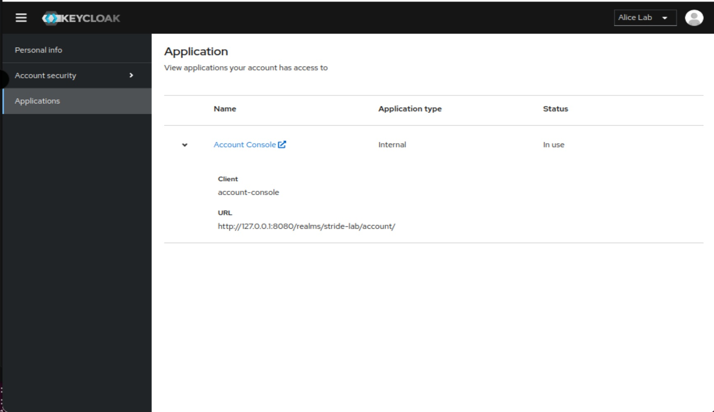
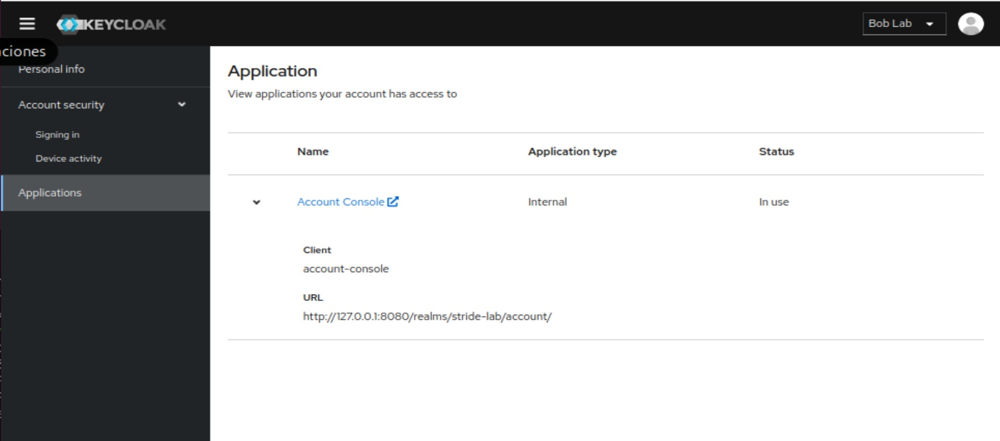

### Authentication Validation

The user `alice` successfully authenticated against the
`stride-lab` realm and accessed the Keycloak Account Console.

- Identity provider: Keycloak 26.4.0
- Realm: stride-lab
- Username: alice
- Expected result: Successful authentication
- Observed result: Successful authentication
- Test result: PASS




The user `bob` successfully authenticated against the
`stride-lab` realm and accessed the Keycloak Account Console.

- Identity provider: Keycloak 26.4.0
- Realm: stride-lab
- Username: bob
- Expected result: Successful authentication
- Observed result: Successful authentication
- Test result: PASS




### Audience Validation

#### Objective

Ensure that Keycloak access tokens include the Claims API
as an intended audience.

#### Initial Finding

The initial generated access token contained only
`account` in the audience claim.

#### Configuration

- Mapper: claims-api-audience
- Mapper type: Audience
- Included Client Audience: claims-api
- Add to access token: Enabled
- Add to ID token: Disabled

#### Retest Results

The generated access token payload now includes:

```json
"aud": [
  "claims-api",
  "account"
]
```

- Expected result: claims-api included in audience
- Observed result: claims-api included in audience
- Configuration validation: PASS

The exact cause of the initial failure was not conclusively
established.

#### Security Rationale

Audience validation prevents the Claims API from accepting
tokens intended exclusively for other services.

#### Evidence

