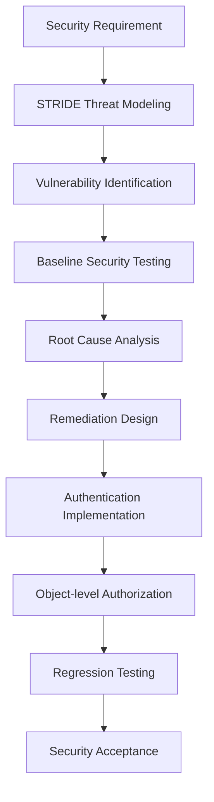

# BOLA Security Validation

## 1. Executive Summary

This security validation exercise evaluates
Broken Object Level Authorization (BOLA)
within the Novaris Insurance Claims API.

The exercise demonstrates the complete security
validation lifecycle, from vulnerability
identification to remediation and regression
testing.

## 2. Security Classification

| Framework | Classification |
|---|---|
| OWASP API Security | API1:2023 - BOLA |
| STRIDE | Information Disclosure |
| STRIDE | Elevation of Privilege |
| CWE | CWE-639 - Authorization Bypass Through User-Controlled Key |
| Attack category | Horizontal Privilege Escalation |

## 3. Security Requirement

An authenticated customer must only be able
to access insurance claims that they are
authorized to view.

The identity supplied by the requester must
not be trusted without authentication.

Access to individual resources must be
explicitly authorized by the application.

## 4. Vulnerability Summary

The original Claims API accepted a user
identity through a query parameter without
validating authentication or object ownership.

This allowed customers to retrieve insurance
claims belonging to other customers.

## 5. Baseline Validation Results

| Requester | Claim ID | Owner | Expected | Observed | Result |
|---|---|---|---|---|---|
| Alice | 1001 | Alice | 200 | 200 | PASS |
| Alice | 1002 | Bob | 403/404 | 200 | FAIL |
| Bob | 1002 | Bob | 200 | 200 | PASS |
| Bob | 1001 | Alice | 403/404 | 200 | FAIL |

Finding: BOLA vulnerability confirmed.

Detailed evidence:

[TC-BOLA-001](bola/TC-BOLA-001.md)

## 6. Security Validation Lifecycle

## 7. Remediation Strategy

The remediation introduces two independent
security controls:

### Authentication

- Keycloak Identity Provider.
- Signed JWT access tokens.
- Digital signature verification.
- Issuer and audience validation.
- Token expiration validation.

### Authorization

- Trusted subject identifier.
- Resource ownership verification.
- Default-deny access policy.
- Object-level authorization enforcement.

Authentication alone does not prevent BOLA.

## 8. Security Control Traceability

| Requirement | Security Control | Evidence | Status |
|---|---|---|---|
| Trusted user identity | JWT authentication | TC-AUTH-001 | Testing |
| Token integrity | RS256 verification | Authentication tests | Pending validation |
| Authorized resource access | Ownership verification | BOLA regression tests | Planned |
| Prevent cross-user access | Object-level authorization | TC-BOLA-003/005 | Planned |
| Prevent future regression | Automated security tests | pytest | Pending update |

## 9. Validation Progress

- [x] Define security requirements
- [x] Identify STRIDE threats
- [x] Reproduce BOLA vulnerability
- [x] Document baseline evidence
- [x] Analyze root cause
- [x] Define remediation strategy
- [x] Configure Keycloak
- [x] Validate JWKS availability
- [x] Implement JWT authentication module
- [x] Validate missing-token rejection on /me
- [ ] Complete JWT authentication tests
- [ ] Implement object-level authorization
- [ ] Execute regression tests
- [ ] Validate remediation effectiveness
- [ ] Document final security acceptance

## 10. Security Acceptance Criteria

The BOLA vulnerability will be considered
remediated when:

- Authorized customers retain access to
  their own claims.
- Cross-user access is rejected.
- Unauthenticated access is rejected.
- Invalid access tokens are rejected.
- User-supplied identities cannot override
  authenticated identities.
- Unauthorized responses do not disclose
  insurance claim data.
- Automated regression tests pass.

## 11. Current Status

Vulnerability: CONFIRMED

Remediation: IN PROGRESS

Authentication: IMPLEMENTED - TESTING

Object-level authorization: PENDING

Regression validation: PENDING

Git branch: feature/bola-remediation

Last updated: 2026-11-24

## 12. Supporting Documentation

### Architecture and Requirements

- [Security Architecture](architecture.md)
- [Security Requirements](requirements.md)
- [Security Findings](security-findings.md)

### Implementation

- [Keycloak Integration](03-keycloak-integration.md)
- [JWT Authentication](04-jwt-authentication.md)
- [Authorization Remediation](bola/02-authorization-remediation.md)

### Security Validation

- [Baseline Vulnerability Evidence](bola/TC-BOLA-001.md)
- [Regression Testing](bola/04-regression-testing.md)
- [Automated Authorization Tests](../tests/test_authorization.py)

## 13. References

- [OWASP API1:2023 - Broken Object Level Authorization](https://owasp.org/API-Security/editions/2023/en/0xa1-broken-object-level-authorization/)
- [CWE-639](https://cwe.mitre.org/data/definitions/639.html)